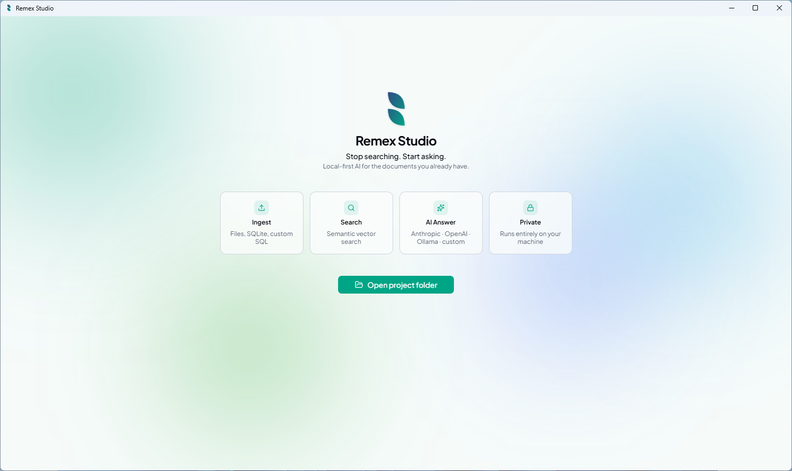
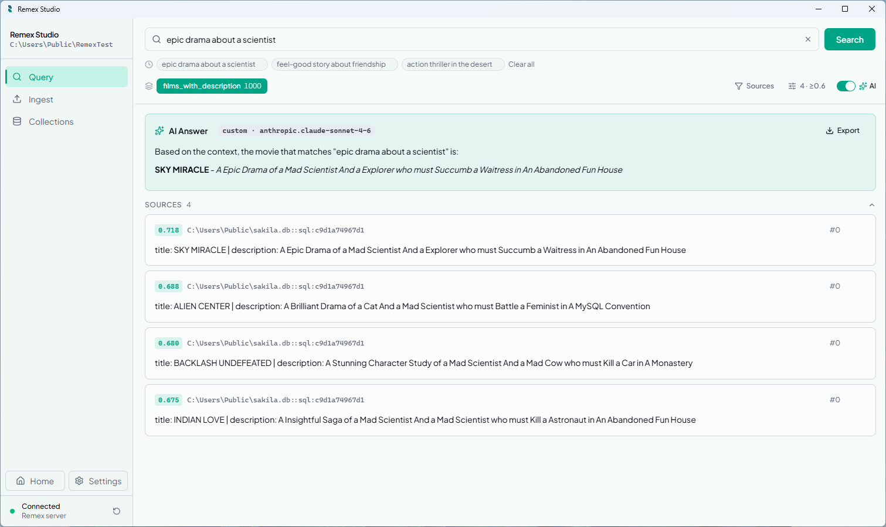

<div align="center">

<br/><br/>

# Remex

### Stop searching. Start asking.

*Local-first AI for the documents you already have.*

[](https://github.com/adm-crow/remex/releases)
[](https://github.com/adm-crow/remex/actions)
[](https://pypi.org/project/remex-cli)
[](LICENSES.md)
[](https://github.com/adm-crow/remex/releases)
[](https://pypi.org/project/remex-cli)

<br/>



</div>

<br/>

Remex ingests PDFs, Word docs, Markdown, spreadsheets, code, web pages, e-books, and SQLite databases into a local vector index, then lets you ask questions in plain language and get answers cited from your own files. Everything — embedding, storage, retrieval — runs on your machine. The AI provider is optional and you bring your own (Anthropic, OpenAI, Ollama, or any OpenAI-compatible endpoint).

<br/>

---

## Install

<table>
<tr>
<td width="50%" valign="top">

### 🖥️ Remex Studio

Native desktop app for Windows. Zero terminal.

**[⬇ Download the latest release][release]**

> [!WARNING]
> Windows SmartScreen may flag the installer because Remex isn't code-signed with a paid certificate. The source is in this repo — audit freely. Click **More info → Run anyway** to proceed.

</td>
<td valign="top">

### ⌨️ Python CLI

```bash
pip install remex-cli                      # core (7 formats)
pip install "remex-cli[formats]"           # +.pptx .xlsx .epub .html .odt
pip install "remex-cli[ai]"                # +Anthropic & OpenAI SDKs
pip install "remex-cli[sentence]"          # +NLTK sentence chunking
pip install "remex-cli[all]"               # everything
```

</td>
</tr>
</table>

<br/>

---

<div align="center">



<sub><em>Ask a question, get a synthesised answer grounded in your own files — with the source chunks and similarity scores one click away.</em></sub>

</div>

<br/>

---

## Features

<table>
<tr>
<td width="33%" valign="top">

### 🔍 Search & answer

- **Semantic search** across one or many collections
- **AI Answer** — synthesised, grounded, sources cited
- **AI personas** — save voices (Researcher, Code Q&A, …) and switch from the Query pane
- **Low-confidence banner** when no chunk scores above `0.70`
- **Source filter** to narrow before searching
- **Searchable query history**
- **Chunk viewer** with keyboard navigation
- **Export** to JSON · CSV · Markdown · BibTeX · RIS · CSL-JSON · Obsidian vault

</td>
<td width="33%" valign="top">

### 📥 Ingest

- **12 file formats**: `.pdf` `.docx` `.md` `.txt` `.csv` `.json` `.jsonl` plus `.html` `.pptx` `.xlsx` `.epub` `.odt`
- **SQLite ingest** — single table *or* a custom SQL query with JOINs
- **Recursive / sentence / word** chunking
- **Incremental** — SHA-256 hash check, only changed rows / files re-processed
- **Auto-ingest** folders and SQLite files on change (debounced)

</td>
<td valign="top">

### ⚙️ Manage & customise

- **All embedding models** — MiniLM, BGE, multilingual, Nomic long-context, plus any HuggingFace / FastEmbed / Ollama model by name
- **Custom OpenAI-compatible providers** for corporate gateways (Azure OpenAI, LiteLLM, vLLM)
- **Custom embedding presets**
- **Per-project defaults** for chunk size, overlap, embedding model, max results, min score
- **Collections manager** — rename, describe, purge, bulk-delete, re-ingest
- **Light · dark · auto** themes, 16 accent colours, 3 home backgrounds
- **Keyboard-first** — press `?` for shortcuts

</td>
</tr>
</table>

> **Remex is free and open-source.** Every feature ships in the box — no tiers, no license keys, no payment required.

<br/>

---

## Privacy & data flow

Remex is **local-first**. Here's exactly what touches the network:

| Operation | Where it runs | Network? |
|:---|:---:|:---|
| File / SQLite extraction & chunking | 🖥 Local | ✗ None |
| Default embedding (`all-MiniLM-L6-v2` or any FastEmbed model) | 🖥 Local (ONNX on CPU) | ✗ None |
| Vector storage (ChromaDB) | 🖥 Local (`./remex_db/`) | ✗ None |
| Vector search (AI Answer **off**) | 🖥 Local | ✗ None |
| **AI Answer (on)** | ☁ Your AI provider | ✓ Question + top-N retrieved chunks sent to the endpoint *you* configured |
| OpenAI embedding model (opt-in) | ☁ OpenAI | ✓ Document text sent to OpenAI during ingest |
| API key storage | 🔐 OS keyring | ✗ Never on disk in plaintext, never transmitted except as the auth header on requests *you* initiate |
| Sidecar HTTP listener | `127.0.0.1` loopback only | ✗ Not reachable from the LAN |

> [!IMPORTANT]
> Remex itself has **no analytics, no telemetry, and no controlled servers** in the request path. The only outbound traffic is to the AI provider you yourself configured — and only when AI Answer is enabled or you submit a query in AI mode.

For zero data egress, point AI Answer at **Ollama** (local) or a self-hosted vLLM/TGI via a Custom Provider.

<br/>

---

## CLI quick start

```bash
# Scaffold a project (creates ./docs, remex.toml, .gitignore entries)
remex init

# Ingest a folder of documents
remex ingest ./docs

# Semantic search
remex query "how does authentication work?"

# AI-synthesised answer (requires ANTHROPIC_API_KEY, OPENAI_API_KEY, or a running Ollama)
remex query "how does authentication work?" --ai
```

### Command reference

| Command | Description |
|:--------|:------------|
| `remex init [path]` | Scaffold `docs/`, `remex.toml`, `.gitignore` entries |
| `remex ingest <dir>` | Ingest files from a directory |
| `remex ingest-sqlite <db>` | Ingest rows from a SQLite table or SQL query |
| `remex query <text>` | Semantic search; add `--ai` for an AI answer |
| `remex sources` | List ingested source paths |
| `remex stats` | Show chunk and source counts |
| `remex delete-source <path>` | Remove all chunks for a source |
| `remex purge` | Remove chunks whose source file no longer exists |
| `remex reset` | Wipe a collection |
| `remex list-collections` | List collections in a database |
| `remex serve` | Start the FastAPI sidecar on `localhost:8000` |

```bash
remex <command> --help    # full option reference for any command
```

### Use as a library

```python
from remex import ingest, query

# Ingest a folder
result = ingest("./docs", collection_name="my-kb")
print(f"{result.chunks_stored} chunks stored")

# Search
results = query("how does auth work?", collection_name="my-kb")
for r in results:
    print(f"[{r.score:.3f}] {r.source}  →  {r.text[:120]}")
```

<br/>

---

## Configuration

Drop a `remex.toml` in your project root (or run `remex init`):

```toml
[remex]
db              = "./remex_db"
collection      = "my-kb"
embedding_model = "all-MiniLM-L6-v2"

# chunk_size     = 768          # characters per chunk (512–1024 works well)
# overlap        = 150          # ~20% overlap preserves context at boundaries
# min_chunk_size = 50           # discard chunks shorter than this
# chunking       = "recursive"  # "recursive" (default) | "sentence" | "word"
```

CLI flags always override `remex.toml`. Studio writes per-project defaults via **Settings → General → Project defaults** when a project is open.

<br/>

---

## Embedding models

| Preset | Model | Size | Notes |
|:-------|:------|:----:|:------|
| **Light** *(default)* | `all-MiniLM-L6-v2` | 22 MB | Fast, good accuracy |
| **Balanced** | `intfloat/e5-base-v2` | 438 MB | Better retrieval quality |
| **Multilingual** | `paraphrase-multilingual-MiniLM-L12-v2` | 470 MB | 50+ languages |
| **Large** | `BAAI/bge-large-en-v1.5` | 1.3 GB | Best English accuracy |
| **E5 Large** | `intfloat/e5-large-v2` | 1.3 GB | Strong retrieval benchmark |
| **Long ctx** | `nomic-ai/nomic-embed-text-v1.5` | 547 MB | 8 192-token context |

Any [SBERT](https://www.sbert.net/docs/pretrained_models.html), [HuggingFace](https://huggingface.co/models?pipeline_tag=sentence-similarity), or [Ollama](https://ollama.com/search?c=embedding) embedding model works — type the model name into the picker. Add your own to **Settings → AI & Server → Embedding presets**.

> [!NOTE]
> **Score interpretation.** ChromaDB returns L2² distance; Remex converts it to `score = 1 / (1 + distance)` so values lie in `(0, 1]`. For normalised embeddings (BGE, MiniLM, Nomic, OpenAI): `0.75+` is near-paraphrase, `0.65–0.75` is strongly relevant, `0.50–0.55` is borderline noise.

<br/>

---

## Under the hood

```
┌────────────────┐   Tauri IPC    ┌────────────────────┐   HTTP/127.0.0.1   ┌──────────────────┐
│  Studio (TS)   │ ─────────────► │  Rust shell        │ ────────────────► │  Python sidecar  │
│  React + Vite  │ ◄───────────── │  (lib.rs)          │ ◄──────────────── │  FastAPI         │
└────────────────┘                └────────────────────┘                    └────────┬─────────┘
                                                                                    │
                                                                                    ▼
                                                                          ┌──────────────────┐
                                                                          │  ChromaDB        │
                                                                          │  FastEmbed/ONNX  │
                                                                          │  ./remex_db/     │
                                                                          └──────────────────┘
```

- **Studio** — Tauri 2, React 18, Zustand, react-query, shadcn/Radix UI
- **Sidecar** — FastAPI on `127.0.0.1`, uv-managed venv in `%APPDATA%\com.remex.studio\`
- **Indexing** — ChromaDB persistent store, FastEmbed ONNX runtime, recursive / sentence / word chunker
- **Secrets** — OS keyring via the [`keyring`][keyring] crate (Windows Credential Manager · macOS Keychain · libsecret)

<br/>

---

## Build from source

> [!TIP]
> Studio requires [Rust][rust], [Node.js 20+][node], and the [Tauri prerequisites][tauri-prereqs] for your OS.

```bash
# Python CLI
pip install -e ".[dev]"
pytest

# Studio (dev server with hot-reload)
cd studio
npm install
npm run tauri dev

# Studio (production build)
npm run tauri build
```

See [`studio/README.md`](studio/README.md) for the full Studio build guide.

<br/>

---

<div align="center">

**[Changelog](CHANGELOG.md) · [Contributing](CONTRIBUTING.md) · [Licensing](LICENSES.md) · [Issues](https://github.com/adm-crow/remex/issues) · [GitHub](https://github.com/adm-crow/remex)**

<sub>Python CLI: Apache-2.0 · Studio (v1.3.0+): FSL-1.1-MIT — see <a href="LICENSES.md">LICENSES.md</a></sub>

</div>

[release]: https://github.com/adm-crow/remex/releases
[rust]: https://rustup.rs/
[node]: https://nodejs.org/
[tauri-prereqs]: https://tauri.app/start/prerequisites/
[keyring]: https://crates.io/crates/keyring
